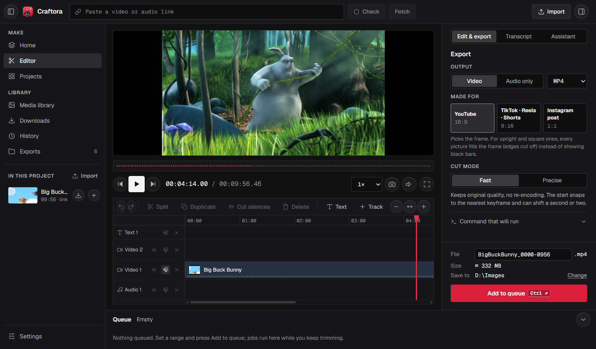

<div align="center">


<h1>Craftora</h1>

<p><strong>A simple Windows video editor, and FETCH anything.</strong></p>

<p>
  <a href="https://github.com/Cchheanglim/Craftora/releases/latest"></a>
  
  <a href="LICENSE"></a>
  <a href="https://github.com/Cchheanglim/Craftora/releases"></a>
  
</p>

<p>
  <a href="https://github.com/Cchheanglim/Craftora/releases/latest"><strong>Download</strong></a> ·
  <a href="#what-you-can-do">Features</a> ·
  <a href="CHANGELOG.md">What's new</a> ·
  <a href="https://github.com/Cchheanglim/Craftora/issues">Report a problem</a>
</p>



<sub>Shown: <em>Big Buck Bunny</em> © Blender Foundation, <a href="https://creativecommons.org/licenses/by/3.0/">CC BY 3.0</a>.</sub>

</div>

Put clips on a timeline, trim and split them, stack picture-in-picture, add titles, music,
voice-overs and captions, cut a video by deleting its words, then export a clean video or audio
file. Files on your PC work offline, and nothing is uploaded.

Craftora is a [Tauri 2](https://tauri.app) app with a React and TypeScript interface.
[FFmpeg](https://ffmpeg.org) and [yt-dlp](https://github.com/yt-dlp/yt-dlp) ship inside it
and do the cutting, rendering and downloading.

> **Status:** young (v0.7) and changing quickly. Please
> [report problems](https://github.com/Cchheanglim/Craftora/issues).

## Download

- **GitHub:** get `Craftora_<version>_x64-setup.exe` from
  [Releases](https://github.com/Cchheanglim/Craftora/releases) and run it. It installs for your
  Windows account without admin rights.
  - The installer isn't code-signed, so Windows SmartScreen may say the publisher is
    unknown: choose **More info**, then **Run anyway**.
  - Craftora checks for updates when it starts and offers to install them. Check by hand or
    turn this off in **Settings → Updates**.
- **Microsoft Store:** submitted, waiting for Microsoft's review. Store copies are signed by
  Microsoft and updated by the Store.

Windows 10 (version 1809 or later) or Windows 11, 64-bit. 8 GB of memory is recommended.

## What you can do

**Bring things in**
- Import video, audio, GIFs and images (PNG, JPEG, WebP, BMP) from your PC: the **Import** button,
  `Ctrl+O`, or drag files onto the window. Imported files work offline, even files of several GB.
  A still image starts at 5 seconds on the timeline; drag its edge to show it for longer.
- Paste a link (pasting fetches it right away) from YouTube or any of the
  [many sites yt-dlp supports](https://github.com/yt-dlp/yt-dlp/blob/master/supportedsites.md).
  Craftora checks the video's preview picture and sound at the same time and shows each step while it
  reads the link ("Reading the page", "Getting the site's player", "Checking the preview"), then shows
  what it found (picture, title, length, qualities, size and captions) before you click **Add to
  project**. Only the parts you use are downloaded when you export, or click the download button to
  save the whole video for smoother, offline editing.
- **Downloads that go on after closing the window:** downloads can be **paused**, resumed later and
  **renamed** while they run. Closing the window while downloads run closes Craftora for real (giving
  back its memory) and finishes them from its icon by the clock, two at a time. Point at a download in
  that menu to **Pause**, **Resume** or **Cancel** it, or open Downloads, and Windows notifies you when
  downloads finish or fail. Opening Craftora again carries on with them without downloading twice.
- **Live streams:** paste the link to a stream that's on right now. Craftora records it while you
  edit, and **Stop recording** turns it into a normal video file.
- **Links that need a login** (private, age-restricted, members-only): click **Sign in to …** on
  the error. Craftora opens its own small browser window (separate from your own browser); log
  in, then click **Fetch this video**. It finds players embedded from other sites too. The login
  is remembered and only used for that website, and Settings lists every website that saved
  cookies, with **Forget** and **Hide**. Ads and trackers are blocked in that window (switch it
  off in **Settings → Privacy** if a site's login stops working).
- **Sites that block bots** (such as Cloudflare's check): Craftora tries again as a browser and
  edits the downloaded copy.
- Downloads go to your **Downloads** folder, or one you choose in **Settings → Saving**. Every
  download is checked to verify it's a real video or sound file and scanned by your PC's antivirus.
  Craftora also checks once a week for a newer quick-starting yt-dlp and updates it in its own folder
  (in the Microsoft Store copy too).
- **Not sure a link is safe?** Click **Check** next to the top link box: Craftora asks
  [VirusTotal](https://www.virustotal.com) whether security vendors flag its website (only the
  website's name is sent, never the full link). It uses your own free VirusTotal key, added once
  in Settings → Links.
- Link previews are cached on your PC as they play, so jumping back is instant; stream playlists and
  formats the player can't open directly copy in as they play within seconds and can be paused. They
  play the best quality the video has; the picker next to the speed (**Best**, 1080p, 720p…) lowers it
  for slow Wi-Fi.

  

**Captions and edit by text**
- **Captions from the website:** when a fetched video has its own captions (in English or Khmer,
  including stream captions and captions listed separately by a site's player via **Fetch this
  video**), pick any track from the list in the **Transcript** tab, grouped by language.
- Otherwise Craftora **listens to the sound and writes them**, on your PC, without internet (Khmer
  and Thai too), using your processor or graphics card (NVIDIA, AMD or Intel Arc, in **Settings →
  Preferences → Make captions with**). Captions fill in as they are made, timed to when the words are
  said, and songs can pull timed lyrics from lrclib.net when found there.
- With **CC** on, captions show on the preview and go into the export. **Drag them anywhere** and
  **resize them from a corner** (all captions together), or pick **Top / Middle / Bottom**. Long
  lines wrap to fit the picture. **Add captions** puts them on a track as text you can edit.
- **Style captions:** click them on the preview to pick the font, colour, size and a shadow,
  outline or dark box. **Open captions file** brings in your own `.srt`, `.vtt` or `.lrc`; **Save as
  .srt** saves them for YouTube or any player.
- The **Transcript** tab shows what's said with the current line and word marked in red. Click a word
  to jump there, select words and press **Delete** to cut them out of the video, or **search a word or
  phrase** to mark every place it's said and cut them all in one click (**Cut every "um"**, whole words
  only) or one line at a time with the scissors button. **Replace all** fixes a wrong word or name in
  every caption at once.

**Edit on the timeline**
- **Every track works the same:** any track can hold videos, pictures, GIFs, sound, text, shapes,
  filters or effects, and higher tracks draw over lower ones. Drag a clip above the top track or below
  the bottom one to make a new track, or click **+ Track**. Tracks start with the **magnet** off so
  clips move freely; turn it on in a track's `⋯` menu to keep clips back to back. Drag the divider
  beside the track buttons to shrink them to compact mode.
- **GIFs and Sound FX:** keep your own GIFs and meme sounds in the editor's **GIFs** and **Sound FX**
  tabs (and in the Media library). Drag GIFs from File Explorer or a browser, paste a GIF link with
  `Ctrl+V` or in "Paste a GIF link" (Giphy page links too), and they play as moving layers with
  see-through parts kept. Import or paste links to sound files (MP3, WAV, OGG, M4A, AAC or FLAC, up to
  50 MB, or a sound's page) into **Sound FX**, preview each card with its sound wave and play button,
  and click or drag to add it at the playhead. (Settings → Preferences can also show every other sound
  in your Media library under Sound FX.)
- **Voice-over:** click the microphone button on the timeline to pick a mic, run **Test your mic**,
  and record while the video plays muted from the playhead; your voice's wave grows live on its own
  track and saves as an `.m4a`.
- Drag media from the sidebar onto any track (a video on an audio track uses just its sound), trim
  edges, split at the playhead (`S`), duplicate (`Ctrl+D`), **cut silences**, **split by chapters**,
  **freeze frame**, mute, hide or lock any track, right-click a clip for quick actions (including copy
  and paste effects, delete and close gap, export one clip, or **Find file** if moved), and undo or
  redo anything (`Ctrl+Z` / `Ctrl+Y`).
- Click a clip's sound wave to open the **Sound** panel for volume and sound fades. Drag the red
  playhead or anywhere on the ruler, and zoom the timeline all the way out (buttons, slider, `Shift+Z`,
  `Ctrl` + wheel, or touchpad pinch around the playhead). **Cover** on the main track sets the
  project's picture, built into exported videos.

**Shape each clip, filters, effects and transitions** (settings are on the right)
- Move, resize and **stretch from any side** directly on the preview (corners keep the shape;
  right-click the picked item for its menu).
- **Crop** on the picture (Free, Original, 16:9, 9:16, 1:1, 4:3 or 3:4, keeping any part including
  corners), mirror, rotate a quarter turn, **fill the frame**, change speed (`0.25×` to `4×`), fade in
  and out, and set the volume.
- **Adjust & Enhance:** Brightness, Contrast, Saturation, Exposure, Highlights, Shadows, Warmth and
  Sharpen sliders, one-click **Enhance**, and **Remove a colour** (green or blue screen with a picker,
  strength and softness).
- **Voice changer:** on any clip with sound, open the **Voice** tab for **Chipmunk**, **Deep**,
  **Monster**, **Robot**, **Alien**, **Cave**, **Radio** or **Megaphone**, plus a **Pitch** slider
  (up or down by 12 steps).
- **Filters, Effects, Transitions and Shapes** (left panel tabs, each with search and `+` to add at
  the playhead; drop on a clip to put it inside that clip, or on empty track space as a block to
  stretch across several clips):
  - **Filters:** 14 colour looks (tiles show your own frame) with a Strength slider, plus **Adjust
    layer** to colour every picture under it.
  - **Effects:** 31 picture effects (camera moves such as zoom in/out, zoom punch and shake, and styles
    such as cinema bars, vignette, strobe, RGB split, film grain, glitch, VHS, pixelate, kaleidoscope,
    light leak, neon edges, old film and duotone) with Strength and Speed sliders, plus **Slow motion**,
    **Smooth slow-mo** (half speed with new in-between frames), **Speed up** and **Reverse**.
  - **Transitions:** 29 transitions between clips (crossfade, dip to black, flash, fade to white,
    dissolve, blur, squeeze, slides, covers, reveals, zoom, zoom-in blur, wipes, smooth slides, circle,
    circle close, radial, wind and spin) plus **Fade in** and **Fade out** on a clip, with a **Volume**
    slider and **Apply to all cuts**.
  - **Shapes:** 30 shapes (rectangles, circles, stars, hearts, arrows, speech bubbles, lines and more)
    with colour, fill or outline, opacity and angle.
- **Text:** 18 free fonts, 8 style presets, size, colour wheel, edge (shadow, outline or box), place,
  and **Animations** (In: Fade, Pop, Slide up, Typewriter; Out: Fade, Shrink; Loop: Bounce, Pulse).

### Image editor

Open **Image editor** from the main menu or Home to create pictures instead of videos, starting from
preset sizes (Square post, Portrait post, Story, Landscape, Video thumbnail, A4 print), a recent
picture or a photo on your PC.
- **Layers and layer masks:** drag to reorder layers, show/hide, lock, rename, duplicate, adjust
  opacity, set exact X, Y, W and H in pixels, turn 90 degrees or mirror. Add **layer masks** to any
  layer (photos, painting, text or shapes) and paint them with Brush, Eraser, Gradient or Paint bucket
  (`Alt+click` to view the mask alone, `Shift+click` to switch it off, Apply or Delete mask).
- **Painting tools** (on this PC): **Brush** (`B`) and **Eraser** (`E`) with size, hardness, opacity
  and flow (`[` / `]`), **Paint bucket** (`G`, tolerance, contiguous, opacity), **Gradient**
  (`Shift+G`, linear or radial), and **Eyedropper** (`I`), with foreground and background colours.
- **Selections:** **Rectangle** and **Ellipse** select (`M`, `Shift+M`), **Lasso** and **Polygon
  lasso** (`L`, `Shift+L`), **Magic wand** (`W`), and **Select subject** (using Remove background's AI
  on this PC), with New, Add, Subtract and Intersect modes, Feather, Expand/Contract, Inverse,
  copy/cut to a new layer, Delete/Fill, or turn into a layer mask.
- **Adjustments, filters, text and shapes:** **Adjust** with one-click **Enhance**, **Filters**, still
  **Effects**, **Remove a colour**, crop (`C`), text, shapes, zoom/pan (`Ctrl+0`, `Space+drag`, `Tab`
  to hide panels) and a **Do-anything box** (`Ctrl+K`) for quick commands.
- **Remove background:** cuts a person or object out of a photo inside Craftora on your PC (uses your
  graphics card when it can, otherwise the processor, no internet) and creates a layer mask so you can
  paint back missed parts; **Restore** removes the mask.
- **Export picture:** save as **PNG** (with optional see-through background) or **JPG** (quality
  slider), scale `0.5×` to `2×` (or `4×` with **AI sharpen**), with one-click **Enhance colours** and
  **AI sharpen** (runs on your PC, graphics card when it can, no internet) and a draggable
  before/after preview.

**AI assistant** (optional): describe an edit in your own words, or click **AI edit** on the timeline
toolbar and drag over part of a clip to tell the assistant what to do. It uses your own API key for
Gemini, ChatGPT or Claude, or an AI already on this PC (Claude Code, Codex, Gemini CLI, Antigravity,
Ollama, LM Studio), managed in **Settings → Assistant**; see [The AI assistant](#the-ai-assistant).

**Export**
- Click **Export** next to Queue to open export settings (or press `Ctrl+Enter` to add straight away).
- Export **MP4** or **MKV** video, **GIF** (480, 720 or 1080 px wide, 10, 15 or 24 fps, looping forever
  without sound, with estimated file size), or **audio only** (MP3, WAV, FLAC), in 16:9, 9:16 (Shorts
  and Reels), 1:1 or 4:3. **Made for** gives one-click presets for YouTube, TikTok · Reels · Shorts
  and Instagram (upright and square ones make every picture fill the frame).
- Type the file name yourself under **Add to queue**.
- **Fast** export uses your graphics card (NVIDIA, Intel or AMD) when the PC has one (single-video
  edits on NVIDIA run entirely on the graphics card for around twice the speed); **Best quality** uses
  the processor for smaller files.
- **Add to queue** shows a short summary first (quality, length, size, where it's saved).
- Exports run in a queue at the bottom with **time left** shown while you keep editing. **Pause**
  anything in it (downloads carry on where they stopped), and a finish sound and notification tell you
  when a download or export is done (toggle the sound in **Settings → Preferences**). Choose the save
  folder next to **Save to** or in Settings (default: `Videos\Craftora`).
- Open **Command that will run** in the Export window to see the exact FFmpeg and yt-dlp commands.

**Make it yours:** **Settings → Look** picks the colour (**Craftora red**, **Lively** or **Light**)
and **Glass** on or off (the Image editor stays dark).

**Your work is kept**
- Projects save themselves as you edit. The main menu has a page for each kind of thing:
  **Projects**, **Media library** (every file you've imported or fetched, with **All**, **Videos**,
  **Pictures**, **Audio**, **GIFs**, **Sound FX**, **Saved**, **Folders** and your own
  **Collections** tabs you can drag to reorder, folders inside folders with custom covers, search, and
  **Select** mode to tick, move or add several cards at once), **Downloads**, **History** (every link
  you've fetched) and **Exports**. Rest the mouse on a video's picture to see it play, and right-click
  any card to open, rename, duplicate, hide or delete it.
- **Hide** anything on those pages: it moves to a folded **Hidden** list (**Unhide** brings it
  back; nothing is deleted). Settings → Privacy can take the Hidden lists away completely.
- Before anything that can't be undone (deleting a project or file, signing out of a website,
  stopping a recording, closing with an export unfinished), Craftora asks first. Deleted exports and
  downloads go to the Recycle Bin. Edits on the timeline can always be undone with `Ctrl+Z`.

### How export works

- **One untouched clip:** the fast path. For a link, yt-dlp downloads only that section; for
  a file on your PC, FFmpeg copies the section without re-encoding. **Fast** keeps the
  original quality but starts on the nearest keyframe; **Precise** is frame-accurate and
  re-encodes.
- **Anything more** (several clips, tracks, text, crop, speed, fades or transitions):
  Craftora renders the whole timeline in one FFmpeg pass, each clip reading only its own part
  of its file. For links, yt-dlp first downloads just the parts the timeline uses.
### Limitation

- **Thought Craftora can fetch almost every video from any website** Some website will require you for login (often works without login)
- **Some website will not work on preview** , so you need to download it fist

## The AI assistant

1. Open the **Assistant** tab at the top of the right panel (or click **AI edit** on the timeline
   toolbar to drag over part of a clip and ask for an edit there).
2. **AI on this PC:** Craftora lists the AI programs it finds (Claude Code, Codex, Gemini CLI,
   Antigravity) and local AI servers that are running (Ollama, LM Studio). Click **Use**; no key
   is needed, because each one uses its own sign-in. Another local server works too: type its
   address, such as `http://localhost:11434/v1`. AI programs answer more slowly than a key does.
   **Or with an API key:** pick the AI you have an account with and paste its API key:
   [Gemini](https://aistudio.google.com/apikey) (free to start),
   [ChatGPT](https://platform.openai.com/api-keys) or [Claude](https://console.anthropic.com/settings/keys)
   (both need API credit). App subscriptions (Google AI Pro, ChatGPT Plus, Claude Pro) don't
   cover the API, so the key is separate. Craftora tries the key first and only keeps it if it
   works. Manage every connected AI, switch any of them on or off, or scan again for newly installed
   programs in **Settings → Assistant**.
3. Pick a model: Craftora suggests two or three good ones for your key, and **Search all
   models…** finds any other. On Gemini's free plan, if a model is busy or not in your plan, the
   assistant switches to another one by itself. Switch AI any time from the list at the top.
4. Type what you want changed. Everything the assistant does for one message is a single
   undo step (`Ctrl+Z`).

Keys are kept in Windows Credential Manager on your PC and are only ever sent to the service
they belong to (Craftora's screens never see them again, and websites opened in Craftora can't
use them). Each message sends your words and a text description of the timeline (clip names,
times and settings, never the media) to that service. The assistant can't watch or listen to your media, so it can't find silences or
"the funny part" yet. See the [privacy policy](PRIVACY.md).

## Keyboard shortcuts

| Keys | Action |
|---|---|
| `Space` | Play / pause |
| `S` | Split at the playhead |
| `Ctrl+D` | Duplicate the selected clip |
| `Delete` | Delete the selected clip |
| `Ctrl+Z` / `Ctrl+Y` | Undo / redo |
| `I` / `O` | Trim the selected clip's start / end to the playhead |
| `T` | Add text at the playhead |
| `←` / `→` | Back / forward 5 seconds (`Shift`: one frame) |
| `↑` / `↓` | Preview volume up / down |
| `Home` / `End` | Go to the start / end |
| `Shift+Z` | Zoom timeline to fit |
| `F` | Full-screen preview (`Esc` to leave) |
| `Ctrl+O` | Import files |
| `Ctrl+Enter` | Add to the export queue |
| `Ctrl+B` / `Ctrl+Alt+B` | Collapse the left / right panel |
| `Esc` | Deselect |

## Privacy

Craftora goes online only when you ask it to: fetching a link, sending a message to the
assistant, or checking for updates (which you can turn off). Files from your PC are never
uploaded, and captions made from the sound are made on your PC. **Settings → Privacy** takes an
HTTP proxy for every connection Craftora makes, and can hide the Hidden lists. Details:
[PRIVACY.md](PRIVACY.md).

## For developers

### Requirements (Windows)

| Tool | Why | Install |
|---|---|---|
| [Bun](https://bun.sh) | Installs packages and runs scripts | `winget install Oven-sh.Bun` |
| [Rust](https://rustup.rs) | Builds the Tauri backend | `winget install Rustlang.Rustup` |
| Visual Studio Build Tools, with **Desktop development with C++** | The C++ compiler and Windows SDK that Rust needs | `winget install Microsoft.VisualStudio.2022.BuildTools` (tick the C++ workload) |
| WebView2 | Draws the interface | Already part of Windows 10/11 |

Open a **new** terminal after installing so it picks up the new tools.

### Getting started

```powershell
git clone https://github.com/Cchheanglim/Craftora.git
cd Craftora
bun install

# Download yt-dlp, FFmpeg, Deno and whisper.cpp (checksum-verified) into src-tauri/bin/
powershell -ExecutionPolicy Bypass -File scripts/fetch-sidecars.ps1

# Run the desktop app with live reload
bun tauri dev
```

The first `bun tauri dev` compiles the Rust side, which takes a few minutes; later runs are
quick. To update yt-dlp (sites change often), run `scripts/fetch-sidecars.ps1 -Force`.

`bun run dev` serves just the interface at <http://localhost:1420> in a normal browser. It
can't reach your files or the engines, so it runs a demo project and simulates exports.

### Building

- **Installer:** `bun tauri build --no-sign` puts the `.exe` and `.msi` installers in
  `src-tauri/target/release/bundle/`. `--no-sign` skips the update signature, which needs the
  private update key.
- **Microsoft Store package:** `powershell -ExecutionPolicy Bypass -File scripts/make-msix.ps1`
  (add `-Test` without the Store identity file).
- **Releases** are built by GitHub Actions from a version tag. See [RELEASING.md](RELEASING.md).

### Project structure

```
src/                      React + TypeScript interface (plain CSS)
  project/                The editing model
    model.ts              Media, tracks, clips, transitions
    actions.ts            Every edit as a named action (add, move, trim, split, speed…)
    useProject.ts         Project state with undo/redo
    usePlayback.ts        The timeline clock
    exportPlan.ts         Fast cut vs full render, sizes and command preview
  assistant/              The AI assistant: tools (one per edit action) and the chat loop
  components/             Toolbar, Sidebar, Preview, TimelineEditor, Inspector, Transcript,
                          ExportPanel, AssistantPanel, QueueDock, Home and the sidebar
                          pages (Projects, MediaLibrary, Downloads, History, Library, Settings)
  lib/                    Bridges to Rust (engine, storage), updates
  state/useQueue.ts       The export queue
  styles/                 Design tokens and shared controls (see DESIGN.md)
src-tauri/                Rust (Tauri 2)
  src/media.rs            Fetch: yt-dlp --dump-json → formats and preview
  src/media_cache.rs      Link previews from a disk cache; stream relay; big local files
  src/signin.rs           Craftora's browser window: logins, cookies, "Fetch this video"
  src/captions.rs         Captions from websites, .srt files; speech.rs makes them from the sound
  src/live.rs             Recording live streams; page_fetch.rs for bot-checked sites
  src/privacy.rs          The proxy for every connection; ad blocking in the sign-in window
  src/local.rs            Open files with ffprobe; preview copies; sound waves
  src/jobs.rs             Queue plumbing, progress, pause and cancel, fast single cuts
  src/engine.rs           Runs the engines; nothing keeps running after Craftora closes
  src/notify.rs           Windows notifications when a job finishes
  src/virustotal.rs       The link safety check
  src/project.rs          Timeline render: one FFmpeg filter graph
  src/store.rs            Projects, export history and settings on disk
  src/assistant.rs        AI requests (Gemini, OpenAI, Claude); keys in Credential Manager
  msix/                   Microsoft Store package manifest and identity
  bin/                    yt-dlp, FFmpeg, Deno and whisper.cpp (downloaded, not committed)
scripts/                  fetch-sidecars.ps1, make-msix.ps1
.github/workflows/        release.yml: builds and publishes releases
```

**Security:** the interface never builds command lines. It sends structured requests, and
Rust checks them and builds every yt-dlp and FFmpeg argument itself. FFmpeg only reads files
you have opened in Craftora. See [SECURITY.md](SECURITY.md) to report a problem.

**Want to help?** Read [CONTRIBUTING.md](CONTRIBUTING.md).

## Roadmap

- Let the AI assistant hear the media (for example, to find silences).
- Exact word timing for edit by text.
- Faster previews of large files from this PC.
- Code-signed installers on GitHub.

## Responsible use

Please read this before you use Craftora to fetch, download or record anything.

### What Craftora is

Craftora is a general-purpose video editor that can also fetch video from many websites, much
like a web browser can show them. It doesn't host, store, own, sell, provide or endorse any of
that content. It isn't affiliated with, approved by or connected to any of those websites, and
it doesn't include, suggest or link to any place to find movies, shows or other content.

### You are responsible for what you download

- Only download content you own, content you have the rights holder's permission to use, or
  content that is free to use (public domain, or a licence such as Creative Commons that allows it).
- Downloading or sharing movies, TV shows, music, sports broadcasts, games, courses or other
  copyrighted work without permission may be illegal where you live, even if the website lets
  you watch it for free.
- Follow each website's terms of service. Some sites don't allow downloads at all, even of
  videos you can watch there.
- Follow the laws of your country. You alone decide what you fetch, so you alone are
  responsible for it.

### Protected and paid content

Craftora doesn't break or get around copy protection (DRM), paywalls or other technical
protections, and isn't meant to be used that way. Don't use it to copy paid, rented or
subscription content that you aren't allowed to keep.

### No warranty

Craftora and its developers aren't responsible for how you use it, for any content you fetch,
download, record, edit or share with it, or for any loss, damage or legal claim that comes from
that use. The software is provided "as is", without warranty of any kind (see [LICENSE](LICENSE)).

### For rights holders

Craftora doesn't host any content, so we can't remove videos from the internet. To take content
down, contact the website that hosts it. If you think Craftora itself is being used to break your
rights in a way we can help with, [open an issue](https://github.com/Cchheanglim/Craftora/issues).

By using Craftora you agree to use it only in ways that are legal and that respect the rights of
others.

## Licences

Craftora is [MIT-licensed](LICENSE). The bundled engines have their own licences:

- **yt-dlp:** [Unlicense](https://github.com/yt-dlp/yt-dlp/blob/master/LICENSE) (public domain).
- **FFmpeg:** a **GPL** build from [BtbN/FFmpeg-Builds](https://github.com/BtbN/FFmpeg-Builds),
  which includes libx264. The installer ships its licence, and every release attaches the
  exact FFmpeg source and build scripts.
- **Deno** (runs YouTube's player code for yt-dlp): MIT.
- **whisper.cpp** and the Whisper "base" speech model: MIT.

Full details: [THIRD_PARTY_NOTICES.md](THIRD_PARTY_NOTICES.md).

Only download content you have the right to. Respect each site's terms of service.
