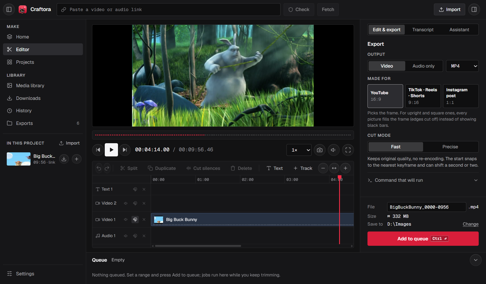

<div align="center">


<h1>Craftora</h1>

<p><strong>A simple Windows video editor, and FETCH anything.</strong></p>

<p>
  <a href="https://github.com/Cchheanglim/Craftora/releases/latest"></a>
  
  <a href="LICENSE"></a>
  <a href="https://github.com/Cchheanglim/Craftora/releases"></a>
  
</p>

<p>
  <a href="https://github.com/Cchheanglim/Craftora/releases/latest"><strong>Download</strong></a> ·
  <a href="#what-you-can-do">Features</a> ·
  <a href="CHANGELOG.md">What's new</a> ·
  <a href="https://github.com/Cchheanglim/Craftora/issues">Report a problem</a>
</p>



<sub>Shown: <em>Big Buck Bunny</em> © Blender Foundation, <a href="https://creativecommons.org/licenses/by/3.0/">CC BY 3.0</a>.</sub>

</div>

Put clips on a timeline, trim and split them, stack picture-in-picture, add titles, music and
voice-overs, then export a clean video or audio file. Files on your PC work offline, and
nothing is uploaded.

Craftora is a [Tauri 2](https://tauri.app) app with a React and TypeScript interface.
[FFmpeg](https://ffmpeg.org) and [yt-dlp](https://github.com/yt-dlp/yt-dlp) ship inside it
and do the cutting, rendering and downloading.

> **Status:** young (v0.3) and changing quickly. Please
> [report problems](https://github.com/Cchheanglim/Craftora/issues).

## Download

- **GitHub:** get `Craftora_<version>_x64-setup.exe` from
  [Releases](https://github.com/Cchheanglim/Craftora/releases) and run it. It installs for your
  Windows account without admin rights.
  - The installer isn't code-signed, so Windows SmartScreen may say the publisher is
    unknown: choose **More info**, then **Run anyway**.
  - Craftora checks for updates when it starts and offers to install them. You can turn this
    off on the Home screen (**About → Check automatically**).
- **Microsoft Store:** submitted, waiting for Microsoft's review. Store copies are signed by
  Microsoft and updated by the Store.

Windows 10 (version 1809 or later) or Windows 11, 64-bit. 8 GB of memory is recommended.

## What you can do

**Bring things in**
- Import video, audio and images (PNG, JPEG, WebP, BMP) from your PC: the **Import** button,
  `Ctrl+O`, or drag files onto the window. Imported files work offline. An image starts at
  5 seconds on the timeline; drag its edge to show it for longer.
- Paste a link from YouTube or any of the [many sites yt-dlp supports](https://github.com/yt-dlp/yt-dlp/blob/master/supportedsites.md)
  and click **Fetch**: the video goes straight onto the timeline, ready to edit (only the parts
  you use are downloaded when you export). The ⬇ button in Media downloads the whole video to
  `Videos\Craftora\Downloads` for smoother, offline editing. Streams the preview can't play are
  downloaded by themselves. Fetched links are kept in **History** in the sidebar.
- **Links that need a login** (private, age-restricted, members-only): click **Sign in to …** on
  the error. Craftora opens its own small browser window (separate from your own browser); log
  in, then click **Fetch this video**. The login is remembered and only used for that website.
  Pages yt-dlp doesn't know ("Unsupported URL") work the same way: open the page, play the
  video, click **Fetch this video**.
- Link previews are cached on your PC as they play: jumping back to any part already fetched
  is instant. Stream playlists (HLS) preview too, including from sites that only serve their
  own pages.
- Files the built-in player can't show (AC-3 or DTS sound, AVI, HEVC and similar) get a
  preview copy made in the background, once. Exports always use the original.

**Edit on the timeline**
- Every video track works the same way: higher tracks are drawn over lower ones, and any
  clip can fill the frame or be a small picture-in-picture. **Audio** tracks hold music and
  voice-overs, **Text** tracks hold titles. Add as many tracks as you like with **+ Track**.
- The **magnet** on a track's header keeps its clips back to back (no gaps) and allows
  transitions; turn it off to place clips anywhere. Video 1 starts with it on.
- Drag media from the sidebar onto any track. A video on an audio track uses just its sound.
- Drag clips to move them and their edges to trim. Split at the playhead (`S`), delete, and
  undo or redo anything (`Ctrl+Z` / `Ctrl+Y`). Edges snap to the playhead and to other clips.
- Drag the red playhead, or anywhere on the ruler, to move through the video.

**Shape each clip** (select it; settings are on the right)
- Move and resize any video or text **directly on the preview**: drag to move, drag a corner
  to resize.
- Crop, mirror, reverse, change speed (0.25× to 4×), fade in and out, and set the volume.
- **Transitions** between clips on a magnetic track: crossfade or dip to black.
- Text: words, size, colour and place.

**AI assistant** (optional): describe an edit in your own words, such as "add the title My
Trip for 3 seconds" or "put crossfades between all the clips", and it makes the edit. It
uses Google's Gemini with your own API key; see [The AI assistant](#the-ai-assistant).

**Export**
- MP4 or MKV video, or audio only (MP3, WAV, FLAC), in 16:9, 9:16 (Shorts and Reels), 1:1
  or 4:3.
- **Fast** export uses your graphics card (NVIDIA, Intel or AMD) when the PC has one, which is
  several times quicker; **Best quality** uses the processor for smaller files.
- Exports run in a queue at the bottom while you keep editing. Choose the save folder next
  to **Save to** in the Export panel (default: `Videos\Craftora`).
- Before anything that can't be undone (deleting a project, cancelling a running export),
  Craftora asks first. Edits on the timeline can always be undone with `Ctrl+Z`.
- Open **Command that will run** in the Export panel to see the exact FFmpeg and yt-dlp
  commands.

**Your work is kept**
- Projects save themselves as you edit. Open, start or delete them on the Home screen.
- Finished exports are listed under **Exports**, even after you restart.

### How export works

- **One untouched clip:** the fast path. For a link, yt-dlp downloads only that section; for
  a file on your PC, FFmpeg copies the section without re-encoding. **Fast** keeps the
  original quality but starts on the nearest keyframe; **Precise** is frame-accurate and
  re-encodes.
- **Anything more** (several clips, tracks, text, crop, speed, fades or transitions):
  Craftora renders the whole timeline in one FFmpeg pass, each clip reading only its own part
  of its file. For links, yt-dlp first downloads just the parts the timeline uses.

## The AI assistant

1. Open the **Assistant** tab at the top of the right panel.
2. Get a free API key from [Google AI Studio](https://aistudio.google.com/apikey) and paste
   it in. A Google AI Pro subscription covers the Gemini app, not the API, so the key is
   separate.
3. Pick a model: Craftora suggests two or three good ones for your key, and **Search all
   models…** finds any other. The free plan covers the Flash models; the largest models may need
   billing in Google AI Studio. If a model is busy or not in your plan, the assistant switches to
   another one by itself.
4. Type what you want changed. Everything the assistant does for one message is a single
   undo step (`Ctrl+Z`).

The key is kept in Windows Credential Manager on your PC. Each message sends your words and
a text description of the timeline (clip names, times and settings, never the media) to
Google. The assistant can't watch or listen to your media, so it can't find silences or
"the funny part" yet. See the [privacy policy](PRIVACY.md).

## Keyboard shortcuts

| Keys | Action |
|---|---|
| `Space` | Play / pause |
| `S` | Split at the playhead |
| `Delete` | Delete the selected clip |
| `Ctrl+Z` / `Ctrl+Y` | Undo / redo |
| `I` / `O` | Trim the selected clip's start / end to the playhead |
| `T` | Add text at the playhead |
| `←` / `→` | Step one frame (`Shift`: one second) |
| `Home` / `End` | Go to the start / end |
| `F` | Full-screen preview (`Esc` to leave) |
| `Ctrl+O` | Import files |
| `Ctrl+Enter` | Add to the export queue |
| `Ctrl+B` / `Ctrl+Alt+B` | Collapse the left / right panel |
| `Esc` | Deselect |

## Privacy

Craftora goes online only when you ask it to: fetching a link, sending a message to the
assistant, or checking for updates (which you can turn off). Files from your PC are never
uploaded. Details: [PRIVACY.md](PRIVACY.md).

## For developers

### Requirements (Windows)

| Tool | Why | Install |
|---|---|---|
| [Bun](https://bun.sh) | Installs packages and runs scripts | `winget install Oven-sh.Bun` |
| [Rust](https://rustup.rs) | Builds the Tauri backend | `winget install Rustlang.Rustup` |
| Visual Studio Build Tools, with **Desktop development with C++** | The C++ compiler and Windows SDK that Rust needs | `winget install Microsoft.VisualStudio.2022.BuildTools` (tick the C++ workload) |
| WebView2 | Draws the interface | Already part of Windows 10/11 |

Open a **new** terminal after installing so it picks up the new tools.

### Getting started

```powershell
git clone https://github.com/Cchheanglim/Craftora.git
cd Craftora
bun install

# Download yt-dlp and FFmpeg (≈ 200 MB, checksum-verified) into src-tauri/bin/
powershell -ExecutionPolicy Bypass -File scripts/fetch-sidecars.ps1

# Run the desktop app with live reload
bun tauri dev
```

The first `bun tauri dev` compiles the Rust side, which takes a few minutes; later runs are
quick. To update yt-dlp (sites change often), run `scripts/fetch-sidecars.ps1 -Force`.

`bun run dev` serves just the interface at <http://localhost:1420> in a normal browser. It
can't reach your files or the engines, so it runs a demo project and simulates exports.

### Building

- **Installer:** `bun tauri build --no-sign` puts the `.exe` and `.msi` installers in
  `src-tauri/target/release/bundle/`. `--no-sign` skips the update signature, which needs the
  private update key.
- **Microsoft Store package:** `powershell -ExecutionPolicy Bypass -File scripts/make-msix.ps1`
  (add `-Test` without the Store identity file).
- **Releases** are built by GitHub Actions from a version tag. See [RELEASING.md](RELEASING.md).

### Project structure

```
src/                      React + TypeScript interface (plain CSS)
  project/                The editing model
    model.ts              Media, tracks, clips, transitions
    actions.ts            Every edit as a named action (add, move, trim, split, speed…)
    useProject.ts         Project state with undo/redo
    usePlayback.ts        The timeline clock
    exportPlan.ts         Fast cut vs full render, sizes and command preview
  assistant/              The AI assistant: tools (one per edit action) and the chat loop
  components/             Toolbar, Sidebar, Preview, TimelineEditor, Inspector,
                          ExportPanel, AssistantPanel, QueueDock, Home, Library
  lib/                    Bridges to Rust (engine, storage), updates
  state/useQueue.ts       The export queue
  styles/                 Design tokens and shared controls (see DESIGN.md)
src-tauri/                Rust (Tauri 2)
  src/media.rs            Fetch: yt-dlp --dump-json → formats and preview
  src/local.rs            Open files with ffprobe; preview copies
  src/jobs.rs             Queue plumbing, progress, cancelling, fast single cuts
  src/project.rs          Timeline render: one FFmpeg filter graph
  src/store.rs            Projects, export history and settings on disk
  src/assistant.rs        Gemini requests; the API key in Credential Manager
  msix/                   Microsoft Store package manifest and identity
  bin/                    yt-dlp and FFmpeg (downloaded, not committed)
scripts/                  fetch-sidecars.ps1, make-msix.ps1
.github/workflows/        release.yml: builds and publishes releases
```

**Security:** the interface never builds command lines. It sends structured requests, and
Rust checks them and builds every yt-dlp and FFmpeg argument itself. FFmpeg only reads files
you have opened in Craftora.

## Roadmap

- Let the AI assistant hear the media (for example, to find silences).
- Faster previews of large files from this PC.
- Code-signed installers on GitHub.

## Licences

Craftora is [MIT-licensed](LICENSE). The bundled engines have their own licences:

- **yt-dlp:** [Unlicense](https://github.com/yt-dlp/yt-dlp/blob/master/LICENSE) (public domain).
- **FFmpeg:** a **GPL** build from [BtbN/FFmpeg-Builds](https://github.com/BtbN/FFmpeg-Builds),
  which includes libx264. The installer ships its licence, and every release attaches the
  exact FFmpeg source and build scripts. See [THIRD_PARTY_NOTICES.md](THIRD_PARTY_NOTICES.md).

Only download content you have the right to. Respect each site's terms of service.
